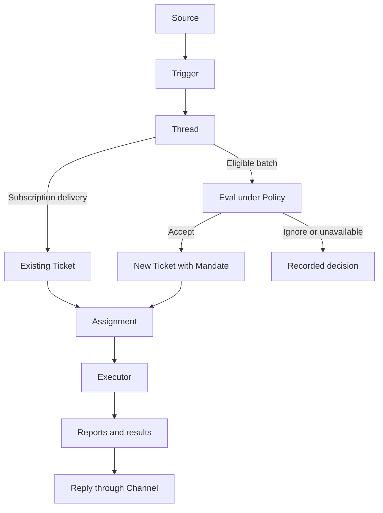



An agent can solve an individual task while still requiring considerable human supervision: opening sessions, supplying context, tracking progress, and transferring results between tools. The Super-agent design discussed in this talk asks how an assistant could take on more of that coordination work.

## 1. Motivation: reduce the cost of supervising agents

The talk describes four desired characteristics:

| Characteristic | What it means in practice |
| --- | --- |
| Continuous | Maintain continuity across conversations, platforms, and tasks. |
| Efficient | Respond promptly while longer tasks proceed in parallel. |
| Proactive | Notice relevant events and advance work within authorized boundaries. |
| Persistent | Remain available over time and recover useful state after interruption. |

The central motivation is that human attention can become a bottleneck as the number of active tasks grows. A user should not have to remember which session owns a task, repeatedly reconstruct its context, or ask for routine progress updates.

## 2. The domain model: events, conversations, and authorized work

A conversation may contain several tasks, and a task may depend on several conversations. Keeping these concepts separate allows the system to route information without treating every message as a new request.

| Concept | Role |
| --- | --- |
| Source | An event integration, including its listening scope and read position. |
| Trigger | An immutable event carrying source metadata, such as its actor. |
| Thread | A source-defined, ordered collection of related Triggers. |
| Policy | Rules governing admission and authorization. |
| Eval | Assessment of a batch of events under the current Policy. |
| Mandate | The recorded scope and basis of an accepted task. |
| Ticket | The durable record of that authorized work. |
| Subscription | A link through which a Ticket receives events from a Thread. |
| Assignment | A binding between a Ticket and an Executor. |
| Channel | An address through which the system can communicate externally. |

The following diagram shows the main relationships. It is a conceptual map, not an exact function-call sequence.

Two distinctions matter throughout the design. **Receiving information does not grant authority to act on it.** Also, correlation between Threads supplies related context; it does not itself route work.

## 3. Coordination: Router, Workers, and two kinds of fast path

### Router and Workers

The talk presents a two-level design. A Router maintains an overview of ongoing work and coordinates task allocation. Workers execute individual tasks in their own sessions.

For example, a bug investigation, a feature implementation, and a code review can proceed separately. The Router needs enough information to understand ownership, progress, and dependencies, without carrying every execution detail in its own prompt.

This creates an immediate design question: how much state should remain in the Router, and when should it retrieve details from a Worker? Too little context can produce poor routing; too much can make coordination expensive and difficult to maintain.

### Admission and routing are different decisions

The talk uses fast path and slow path in two related senses:

| Decision | Programmatic path | Model-assisted path |
| --- | --- | --- |
| Admission | Check scope, actor identity, and configured rules. | Interpret intent and assess whether an eligible event warrants work. |
| Routing | Deliver events through established subscriptions and ownership. | Resolve ambiguous task ownership or assess work outside an existing task's scope. |

These are conceptual categories, not two mutually exclusive branches that describe every line of execution. In particular, **subscription fan-out and evaluation are not always exclusive**: an event may inform existing Tickets and still become an evaluation candidate if it has no owner.

For an owning human follow-up, the existing task handles the message. If the requested work exceeds its Mandate, the Worker can hand it back for assessment rather than silently expanding its authority.

## 4. Context management: Inline & Spill and Chain of Recall

### Inline & Spill

The talk's Inline & Spill pattern addresses a practical tension: a Worker needs enough context to act correctly, but inserting every available artifact makes its prompt large and noisy.

- **Inline:** place information likely to be needed immediately in the prompt, such as the latest request, task scope, and a short status summary.
- **Spill:** retain larger artifacts outside the prompt and provide concise descriptions or references through which they can be retrieved.

Spill does not mean deleting the rest of the information. It means making that information available without paying its full prompt cost at every step.

Consider a coding task. The latest review comment and failing test summary might be inline, while complete logs, earlier discussions, and large diffs remain retrievable. If the Worker needs a specific stack trace, it can fetch the relevant artifact instead of receiving every log in advance.

The context window can therefore be viewed as a cache of currently useful information. This is an analogy about information placement, distinct from a serving system's prompt or KV cache. A smaller prompt is not automatically better: an omitted detail may lead to extra retrieval calls or an incorrect decision.

### Chain of Recall

Inline & Spill determines where information lives. Chain of Recall describes how an agent can find related information through linked objects.

A follow-up in a chat platform might lead to a Thread, then to its Ticket, the Worker's session history, and finally a related pull request or review. This is a conceptual retrieval path; it should not be read as a fixed sequence of API calls.

Each step can expose a small summary and references to deeper material. The useful property is that a short message can remain connected to the evidence and decisions behind it without carrying all that history in the current prompt.

This approach still requires good retrieval decisions. Links alone do not determine which branch to follow, how much history to load, or when to stop searching.

### Connection to context compaction

These ideas suggest a research direction closely related to my interest in agent context management. Inline & Spill controls placement and retrieval; compaction rewrites accumulated context into a shorter representation. They can work together, but they introduce different costs.

Questions worth investigating include:

- Which information should remain inline as the task evolves?
- When does retrieval cost more than retaining the original context?
- When does compaction save enough future cost to justify summarization and cache recomputation?
- How often does omitted or compressed information become necessary later?

These are proposed research questions, not results established by the prototype.

## 5. Persistent execution: a task outlives a model turn

The execution discussion makes a useful distinction between the lifetime of a task and the lifetime of its current execution session. A Ticket records the work; an Assignment records an execution binding. Finishing a model turn does not necessarily finish the task.

A Worker might be running a command, waiting for a person, or awaiting review. Likewise, reporting a pull request as ready does not mean that it has been merged or that all follow-up work is complete.

The implementation preserves task records and execution context across restarts. Its architecture separates stored state changes from queued external effects, supporting recovery and retries. This should not be interpreted as a guarantee that arbitrary external actions execute exactly once.

An illustrative task could unfold as follows:

1. An authorized bug report becomes a Ticket with a defined scope.
2. A Worker investigates the issue, implements a fix, and reports a pull request.
3. Review comments and CI events arrive as further context.
4. The Worker handles applicable follow-ups; requests outside its scope require reassessment.
5. If execution is interrupted, recovery uses persisted state to determine what has already happened before repeating external work.

Persistence also raises a boundary issue. The prototype's policy checks and command wrappers are not an operating-system sandbox; its execution documentation explicitly describes limitations here. Durable execution and permission isolation are separate engineering concerns.

## 6. Speculative execution: spending compute to reduce waiting

The talk proposes doing potentially useful work before its eventual usefulness is certain. For example, under an appropriate standing authorization, an assistant might investigate a likely bug before someone explicitly asks it to do so. If the investigation produces a useful result, that result is ready sooner.

The analogy with speculative decoding is limited. Both spend computation in anticipation of future demand, but speculative agent work does not inherit guarantees about accepted tokens or output distributions. A task may be unnecessary, and interactions with external systems can have lasting effects.

The trade-off is therefore broader than latency alone:

- Useful speculation can shorten the time between a human request and an actionable result.
- Unused speculation consumes compute and may compete with more valuable work.
- Poorly chosen notifications can increase the attention burden that the system was intended to reduce.

A practical design must decide which work is worth starting, what authority permits it, and when the result deserves an interruption. The talk's example illustrates this idea; it does not provide a measured speedup or establish that every speculative task is beneficial.

## 7. What would count as a convincing improvement?

The main takeaway from the talk is that coordination should be evaluated alongside task execution. A system can produce correct code yet still require too much attention to supervise.

The following is a proposed evaluation framework, rather than a report of published experimental results:

| Dimension | Example question or measurement |
| --- | --- |
| Task quality | Does the work pass relevant tests and human review? |
| Human attention | How many interventions, context transfers, and unnecessary notifications are required? |
| Latency | How long until the first useful response and the final usable result? |
| Resource cost | How much model computation, retrieval, and speculative work is consumed? |
| Recovery and scope | Can interrupted tasks resume correctly, and do actions stay within their authorization? |

Several open questions follow. A single Router may become a bottleneck as tasks and dependencies grow. Workers may need richer communication than a simple hierarchy permits. Cross-platform continuity needs a way to preserve private context and respect different access boundaries. Long-term memory also needs selection and retrieval policies, rather than an ever-growing archive.

## Related materials

- **Public prototype:** [README][readme], [philosophy][philosophy], [domain model][domain], [authorization][authorization], [execution][execution], and [architecture][architecture].
- **Code:** [event processing][passes], [intake][intake], [evaluation][evals], [policy gate][policy-code], and [assessment][assessment].

Repository links below are pinned to commit `8c32a9dc5d72c033816c6a8110b37f40cf94fba4`, checked on November 19, 2026, so that later implementation changes do not silently change the reference for these notes.

[readme]: https://github.com/deepseek-ai/dsh-superagent-prototype/blob/8c32a9dc5d72c033816c6a8110b37f40cf94fba4/README.md
[philosophy]: https://github.com/deepseek-ai/dsh-superagent-prototype/blob/8c32a9dc5d72c033816c6a8110b37f40cf94fba4/docs/000-philosophy.md
[domain]: https://github.com/deepseek-ai/dsh-superagent-prototype/blob/8c32a9dc5d72c033816c6a8110b37f40cf94fba4/docs/001-domain.md
[authorization]: https://github.com/deepseek-ai/dsh-superagent-prototype/blob/8c32a9dc5d72c033816c6a8110b37f40cf94fba4/docs/002-authorization.md
[execution]: https://github.com/deepseek-ai/dsh-superagent-prototype/blob/8c32a9dc5d72c033816c6a8110b37f40cf94fba4/docs/003-execution.md
[architecture]: https://github.com/deepseek-ai/dsh-superagent-prototype/blob/8c32a9dc5d72c033816c6a8110b37f40cf94fba4/docs/007-architecture.md
[passes]: https://github.com/deepseek-ai/dsh-superagent-prototype/blob/8c32a9dc5d72c033816c6a8110b37f40cf94fba4/src/app/passes.ts
[intake]: https://github.com/deepseek-ai/dsh-superagent-prototype/blob/8c32a9dc5d72c033816c6a8110b37f40cf94fba4/src/core/intake.ts
[evals]: https://github.com/deepseek-ai/dsh-superagent-prototype/blob/8c32a9dc5d72c033816c6a8110b37f40cf94fba4/src/core/evals.ts
[policy-code]: https://github.com/deepseek-ai/dsh-superagent-prototype/blob/8c32a9dc5d72c033816c6a8110b37f40cf94fba4/src/policy.ts
[assessment]: https://github.com/deepseek-ai/dsh-superagent-prototype/blob/8c32a9dc5d72c033816c6a8110b37f40cf94fba4/src/app/assessment.ts

[Back to Notes]({{ "/notes/" | relative_url }})
